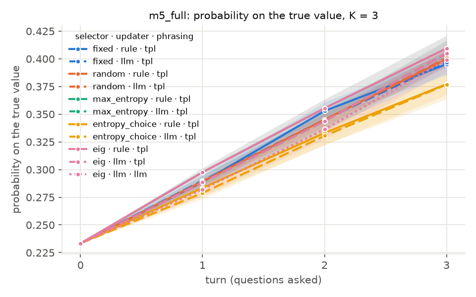
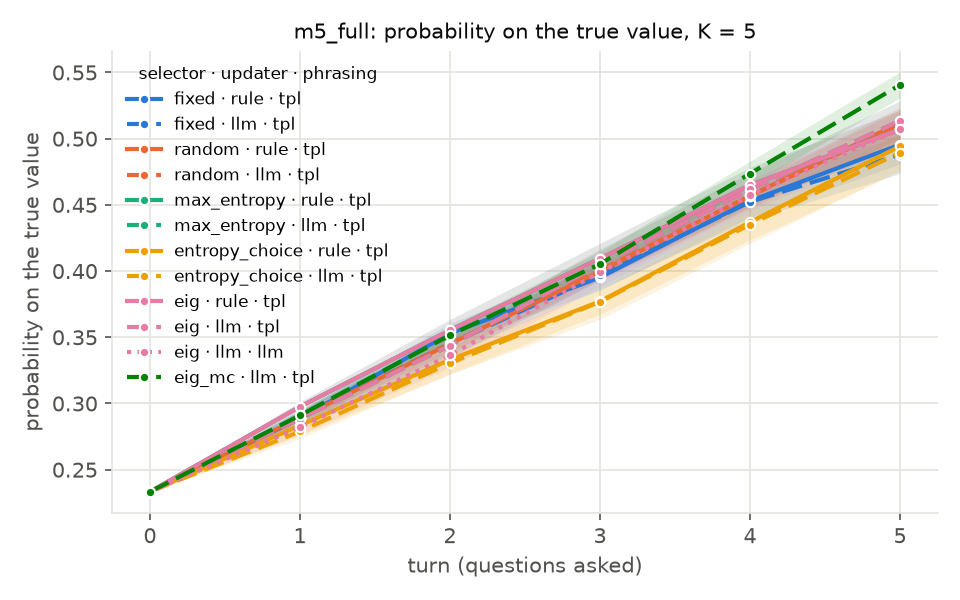
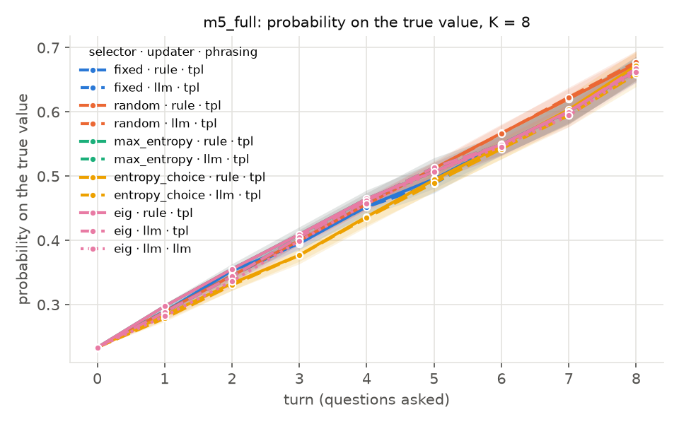
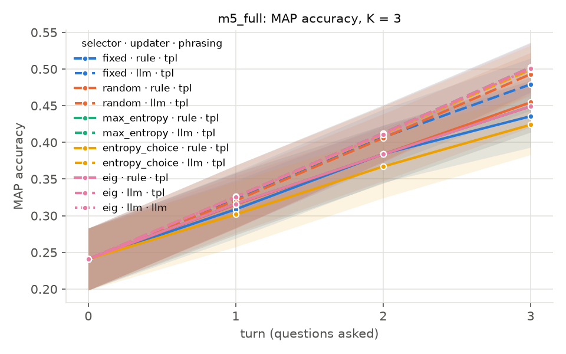
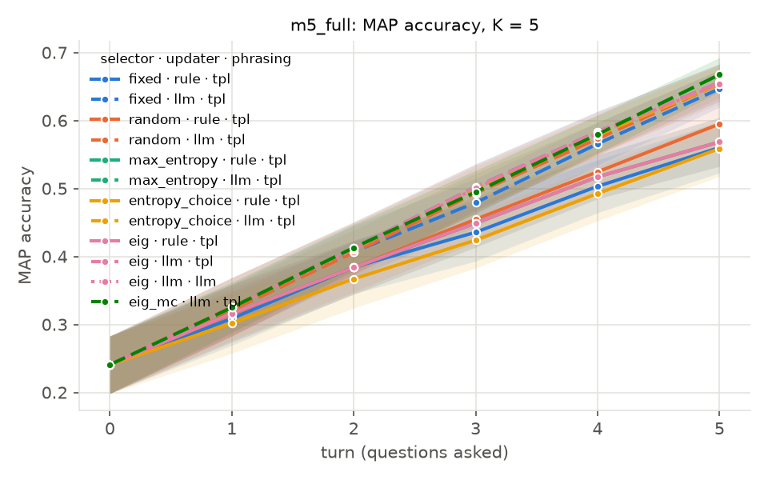
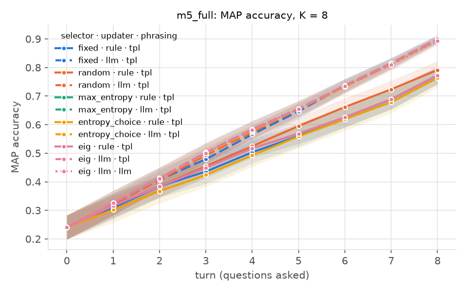
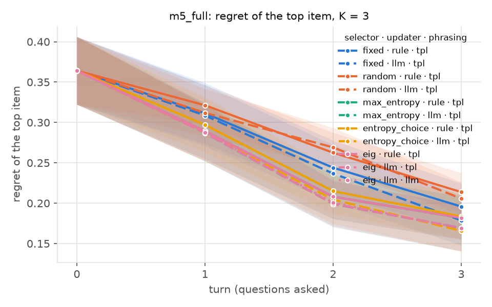
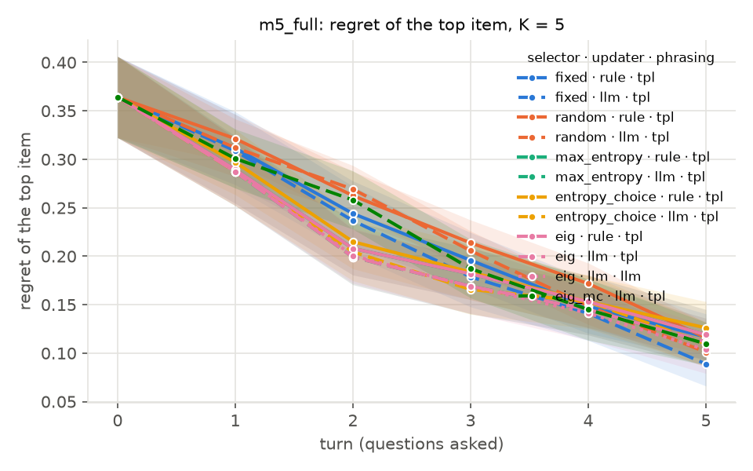
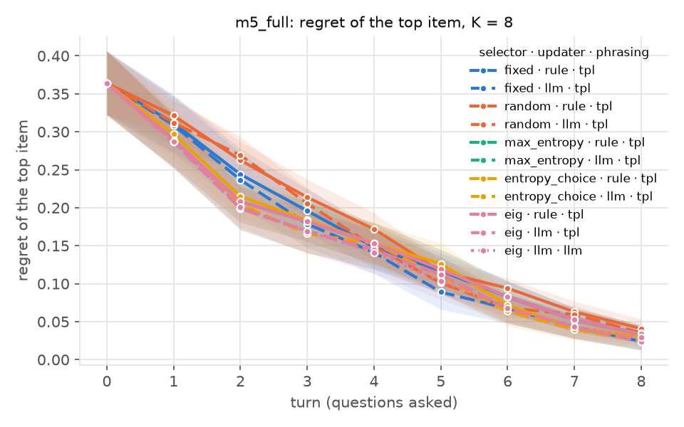

# Results: m5_full

- Personas: 48 (eval split), replicates: 5, budgets: 3, 5, 8
- Simulator: llm, LLM provider: ollama
- Cells finished: 60 of 60
- Run fingerprint: `1d7d03d877b0093a`, package version 0.0.1

Means over personas (replicates averaged first) with 95 % bootstrap CIs.

## Budget K = 3

| arm | mass_on_truth | map_accuracy | log_loss | regret | hit@1 | violations | map_auc | turns |
|---|---|---|---|---|---|---|---|---|
| `sel=fixed,upd=rule,phr=tpl` | 0.395 [0.385, 0.405] | 0.436 [0.395, 0.479] | 1.619 [1.585, 1.656] | 0.196 [0.168, 0.224] | 0.137 [0.062, 0.225] | 1.238 [1.075, 1.392] | 0.344 [0.307, 0.384] | 3.000 [3.000, 3.000] |
| `sel=fixed,upd=llm,phr=tpl` | 0.397 [0.386, 0.407] | 0.479 [0.445, 0.515] | 1.590 [1.563, 1.620] | 0.179 [0.148, 0.209] | 0.162 [0.071, 0.267] | 1.158 [0.979, 1.333] | 0.363 [0.327, 0.401] | 3.000 [3.000, 3.000] |
| `sel=random,upd=rule,phr=tpl` | 0.400 [0.392, 0.407] | 0.455 [0.421, 0.489] | 1.603 [1.576, 1.632] | 0.214 [0.191, 0.237] | 0.112 [0.062, 0.167] | 0.804 [0.683, 0.925] | 0.349 [0.313, 0.387] | 3.000 [3.000, 3.000] |
| `sel=random,upd=llm,phr=tpl` | 0.401 [0.394, 0.408] | 0.493 [0.465, 0.523] | 1.574 [1.556, 1.592] | 0.206 [0.185, 0.226] | 0.104 [0.058, 0.158] | 0.742 [0.625, 0.862] | 0.365 [0.331, 0.400] | 3.000 [3.000, 3.000] |
| `sel=max_entropy,upd=rule,phr=tpl` | 0.409 [0.398, 0.421] | 0.449 [0.415, 0.485] | 1.541 [1.500, 1.583] | 0.182 [0.155, 0.208] | 0.108 [0.033, 0.200] | 1.108 [0.929, 1.283] | 0.348 [0.311, 0.388] | 3.000 [3.000, 3.000] |
| `sel=max_entropy,upd=llm,phr=tpl` | 0.405 [0.393, 0.416] | 0.502 [0.470, 0.537] | 1.521 [1.492, 1.551] | 0.169 [0.140, 0.197] | 0.104 [0.021, 0.188] | 1.150 [0.979, 1.325] | 0.370 [0.333, 0.410] | 3.000 [3.000, 3.000] |
| `sel=entropy_choice,upd=rule,phr=tpl` | 0.377 [0.364, 0.391] | 0.424 [0.384, 0.465] | 1.654 [1.596, 1.715] | 0.184 [0.155, 0.212] | 0.104 [0.021, 0.208] | 1.129 [0.967, 1.292] | 0.334 [0.294, 0.376] | 3.000 [3.000, 3.000] |
| `sel=entropy_choice,upd=llm,phr=tpl` | 0.377 [0.367, 0.386] | 0.499 [0.468, 0.533] | 1.580 [1.556, 1.605] | 0.166 [0.140, 0.192] | 0.096 [0.021, 0.183] | 1.100 [0.921, 1.279] | 0.369 [0.333, 0.409] | 3.000 [3.000, 3.000] |
| `sel=eig,upd=rule,phr=tpl` | 0.409 [0.398, 0.421] | 0.449 [0.415, 0.485] | 1.541 [1.500, 1.583] | 0.182 [0.155, 0.208] | 0.108 [0.033, 0.200] | 1.108 [0.929, 1.283] | 0.348 [0.311, 0.388] | 3.000 [3.000, 3.000] |
| `sel=eig,upd=llm,phr=tpl` | 0.405 [0.393, 0.416] | 0.502 [0.470, 0.537] | 1.521 [1.492, 1.551] | 0.169 [0.140, 0.197] | 0.104 [0.021, 0.188] | 1.150 [0.979, 1.325] | 0.370 [0.333, 0.410] | 3.000 [3.000, 3.000] |
| `sel=eig,upd=llm,phr=llm` | 0.399 [0.388, 0.409] | 0.500 [0.468, 0.535] | 1.533 [1.507, 1.561] | 0.169 [0.141, 0.197] | 0.100 [0.021, 0.188] | 1.133 [0.954, 1.312] | 0.369 [0.332, 0.410] | 3.000 [3.000, 3.000] |

## Budget K = 5

| arm | mass_on_truth | map_accuracy | log_loss | regret | hit@1 | violations | map_auc | turns |
|---|---|---|---|---|---|---|---|---|
| `sel=fixed,upd=rule,phr=tpl` | 0.495 [0.481, 0.509] | 0.560 [0.524, 0.598] | 1.311 [1.259, 1.366] | 0.117 [0.093, 0.140] | 0.267 [0.158, 0.383] | 1.113 [0.954, 1.275] | 0.406 [0.370, 0.446] | 5.000 [5.000, 5.000] |
| `sel=fixed,upd=llm,phr=tpl` | 0.488 [0.473, 0.502] | 0.647 [0.621, 0.674] | 1.274 [1.237, 1.312] | 0.089 [0.067, 0.112] | 0.317 [0.192, 0.450] | 1.079 [0.912, 1.250] | 0.443 [0.411, 0.478] | 5.000 [5.000, 5.000] |
| `sel=random,upd=rule,phr=tpl` | 0.512 [0.500, 0.523] | 0.595 [0.563, 0.625] | 1.264 [1.222, 1.309] | 0.116 [0.101, 0.131] | 0.242 [0.175, 0.308] | 0.696 [0.588, 0.804] | 0.419 [0.386, 0.454] | 5.000 [5.000, 5.000] |
| `sel=random,upd=llm,phr=tpl` | 0.511 [0.500, 0.522] | 0.654 [0.634, 0.675] | 1.223 [1.197, 1.250] | 0.101 [0.086, 0.116] | 0.304 [0.229, 0.379] | 0.725 [0.633, 0.821] | 0.448 [0.419, 0.479] | 5.000 [5.000, 5.000] |
| `sel=max_entropy,upd=rule,phr=tpl` | 0.507 [0.493, 0.521] | 0.569 [0.534, 0.605] | 1.263 [1.210, 1.317] | 0.119 [0.094, 0.145] | 0.217 [0.113, 0.333] | 1.204 [1.058, 1.358] | 0.414 [0.381, 0.450] | 5.000 [5.000, 5.000] |
| `sel=max_entropy,upd=llm,phr=tpl` | 0.513 [0.498, 0.528] | 0.656 [0.629, 0.683] | 1.195 [1.156, 1.236] | 0.112 [0.088, 0.136] | 0.221 [0.117, 0.337] | 1.238 [1.071, 1.400] | 0.454 [0.422, 0.490] | 5.000 [5.000, 5.000] |
| `sel=entropy_choice,upd=rule,phr=tpl` | 0.494 [0.476, 0.512] | 0.559 [0.518, 0.598] | 1.326 [1.249, 1.409] | 0.126 [0.099, 0.154] | 0.208 [0.104, 0.325] | 1.225 [1.067, 1.387] | 0.397 [0.359, 0.437] | 5.000 [5.000, 5.000] |
| `sel=entropy_choice,upd=llm,phr=tpl` | 0.490 [0.475, 0.504] | 0.654 [0.627, 0.682] | 1.237 [1.203, 1.275] | 0.110 [0.087, 0.132] | 0.225 [0.121, 0.342] | 1.213 [1.046, 1.375] | 0.452 [0.420, 0.488] | 5.000 [5.000, 5.000] |
| `sel=eig,upd=rule,phr=tpl` | 0.507 [0.493, 0.521] | 0.569 [0.534, 0.605] | 1.263 [1.210, 1.317] | 0.119 [0.094, 0.145] | 0.217 [0.113, 0.333] | 1.204 [1.058, 1.358] | 0.414 [0.381, 0.450] | 5.000 [5.000, 5.000] |
| `sel=eig,upd=llm,phr=tpl` | 0.513 [0.498, 0.528] | 0.656 [0.629, 0.683] | 1.195 [1.156, 1.236] | 0.112 [0.088, 0.136] | 0.221 [0.117, 0.337] | 1.238 [1.071, 1.400] | 0.454 [0.422, 0.490] | 5.000 [5.000, 5.000] |
| `sel=eig,upd=llm,phr=llm` | 0.507 [0.493, 0.520] | 0.654 [0.626, 0.683] | 1.204 [1.170, 1.239] | 0.104 [0.079, 0.128] | 0.250 [0.138, 0.371] | 1.179 [1.017, 1.342] | 0.453 [0.420, 0.489] | 5.000 [5.000, 5.000] |
| `sel=eig_mc,upd=llm,phr=tpl` | 0.541 [0.531, 0.550] | 0.668 [0.643, 0.692] | 1.156 [1.131, 1.181] | 0.110 [0.088, 0.132] | 0.217 [0.125, 0.317] | 0.338 [0.221, 0.458] | 0.453 [0.423, 0.485] | 5.000 [5.000, 5.000] |

## Budget K = 8

| arm | mass_on_truth | map_accuracy | log_loss | regret | hit@1 | violations | map_auc | turns |
|---|---|---|---|---|---|---|---|---|
| `sel=fixed,upd=rule,phr=tpl` | 0.665 [0.647, 0.683] | 0.772 [0.742, 0.802] | 0.795 [0.732, 0.862] | 0.034 [0.023, 0.046] | 0.617 [0.496, 0.733] | 0.992 [0.842, 1.146] | 0.502 [0.469, 0.537] | 8.000 [8.000, 8.000] |
| `sel=fixed,upd=llm,phr=tpl` | 0.668 [0.649, 0.686] | 0.900 [0.886, 0.914] | 0.714 [0.668, 0.762] | 0.024 [0.013, 0.036] | 0.713 [0.592, 0.825] | 0.938 [0.779, 1.096] | 0.568 [0.542, 0.595] | 8.000 [8.000, 8.000] |
| `sel=random,upd=rule,phr=tpl` | 0.675 [0.658, 0.691] | 0.792 [0.760, 0.822] | 0.768 [0.709, 0.830] | 0.041 [0.029, 0.054] | 0.575 [0.471, 0.679] | 0.725 [0.592, 0.862] | 0.522 [0.491, 0.553] | 8.000 [8.000, 8.000] |
| `sel=random,upd=llm,phr=tpl` | 0.677 [0.660, 0.694] | 0.898 [0.888, 0.906] | 0.699 [0.656, 0.745] | 0.035 [0.028, 0.044] | 0.575 [0.492, 0.658] | 0.717 [0.579, 0.862] | 0.571 [0.548, 0.595] | 8.000 [8.000, 8.000] |
| `sel=max_entropy,upd=rule,phr=tpl` | 0.665 [0.647, 0.683] | 0.772 [0.742, 0.802] | 0.795 [0.732, 0.862] | 0.034 [0.023, 0.046] | 0.617 [0.496, 0.733] | 0.992 [0.842, 1.146] | 0.507 [0.475, 0.540] | 8.000 [8.000, 8.000] |
| `sel=max_entropy,upd=llm,phr=tpl` | 0.668 [0.649, 0.686] | 0.900 [0.886, 0.914] | 0.714 [0.668, 0.762] | 0.024 [0.013, 0.036] | 0.713 [0.592, 0.825] | 0.938 [0.779, 1.096] | 0.575 [0.549, 0.603] | 8.000 [8.000, 8.000] |
| `sel=entropy_choice,upd=rule,phr=tpl` | 0.672 [0.649, 0.694] | 0.763 [0.730, 0.796] | 0.839 [0.739, 0.946] | 0.030 [0.020, 0.041] | 0.637 [0.513, 0.754] | 0.925 [0.758, 1.096] | 0.493 [0.457, 0.529] | 8.000 [8.000, 8.000] |
| `sel=entropy_choice,upd=llm,phr=tpl` | 0.659 [0.639, 0.678] | 0.897 [0.883, 0.911] | 0.723 [0.677, 0.772] | 0.025 [0.014, 0.037] | 0.717 [0.600, 0.825] | 0.887 [0.729, 1.050] | 0.573 [0.547, 0.601] | 8.000 [8.000, 8.000] |
| `sel=eig,upd=rule,phr=tpl` | 0.665 [0.647, 0.683] | 0.772 [0.742, 0.802] | 0.795 [0.732, 0.862] | 0.034 [0.023, 0.046] | 0.617 [0.496, 0.733] | 0.992 [0.842, 1.146] | 0.507 [0.475, 0.540] | 8.000 [8.000, 8.000] |
| `sel=eig,upd=llm,phr=tpl` | 0.668 [0.649, 0.686] | 0.900 [0.886, 0.914] | 0.714 [0.668, 0.762] | 0.024 [0.013, 0.036] | 0.713 [0.592, 0.825] | 0.938 [0.779, 1.096] | 0.575 [0.549, 0.603] | 8.000 [8.000, 8.000] |
| `sel=eig,upd=llm,phr=llm` | 0.662 [0.645, 0.679] | 0.894 [0.877, 0.911] | 0.719 [0.679, 0.763] | 0.030 [0.018, 0.044] | 0.671 [0.550, 0.783] | 0.917 [0.771, 1.067] | 0.573 [0.546, 0.602] | 8.000 [8.000, 8.000] |

## Paired comparisons

A − B per persona, Wilcoxon signed-rank (two-sided), Holm-adjusted within each metric. W/T/L counts personas where A is better / tied / worse.

### mass_on_truth (higher is better)

| A | B | K | A − B [95 % CI] | W/T/L | p | p (Holm) |
|---|---|---|---|---|---|---|
| `sel=eig,upd=llm,phr=tpl` | `sel=fixed,upd=llm,phr=tpl` | 3 | +0.008 [-0.003, +0.019] | 35/0/13 | 0.056 | 1.000 |
| `sel=eig,upd=llm,phr=tpl` | `sel=fixed,upd=llm,phr=tpl` | 5 | +0.026 [+0.019, +0.032] | 42/0/6 | <0.001 | <0.001 |
| `sel=eig,upd=llm,phr=tpl` | `sel=fixed,upd=llm,phr=tpl` | 8 | +0.000 [+0.000, +0.000] | 0/48/0 | 1.000 | 1.000 |
| `sel=eig,upd=llm,phr=tpl` | `sel=random,upd=llm,phr=tpl` | 3 | +0.004 [-0.005, +0.013] | 33/0/15 | 0.295 | 1.000 |
| `sel=eig,upd=llm,phr=tpl` | `sel=random,upd=llm,phr=tpl` | 5 | +0.002 [-0.006, +0.011] | 23/0/25 | 0.741 | 1.000 |
| `sel=eig,upd=llm,phr=tpl` | `sel=random,upd=llm,phr=tpl` | 8 | -0.010 [-0.013, -0.007] | 14/1/33 | <0.001 | <0.001 |
| `sel=eig,upd=rule,phr=tpl` | `sel=fixed,upd=rule,phr=tpl` | 3 | +0.014 [+0.000, +0.028] | 32/0/16 | 0.030 | 1.000 |
| `sel=eig,upd=rule,phr=tpl` | `sel=fixed,upd=rule,phr=tpl` | 5 | +0.012 [+0.002, +0.021] | 36/2/10 | 0.004 | 0.133 |
| `sel=eig,upd=rule,phr=tpl` | `sel=fixed,upd=rule,phr=tpl` | 8 | +0.000 [+0.000, +0.000] | 0/48/0 | 1.000 | 1.000 |
| `sel=eig,upd=rule,phr=tpl` | `sel=random,upd=rule,phr=tpl` | 3 | +0.010 [+0.001, +0.018] | 35/0/13 | 0.012 | 0.395 |
| `sel=eig,upd=rule,phr=tpl` | `sel=random,upd=rule,phr=tpl` | 5 | -0.005 [-0.014, +0.004] | 24/0/24 | 0.389 | 1.000 |
| `sel=eig,upd=rule,phr=tpl` | `sel=random,upd=rule,phr=tpl` | 8 | -0.010 [-0.014, -0.006] | 14/3/31 | <0.001 | 0.001 |
| `sel=eig,upd=llm,phr=tpl` | `sel=max_entropy,upd=llm,phr=tpl` | 3 | +0.000 [+0.000, +0.000] | 0/48/0 | 1.000 | 1.000 |
| `sel=eig,upd=llm,phr=tpl` | `sel=max_entropy,upd=llm,phr=tpl` | 5 | +0.000 [+0.000, +0.000] | 0/48/0 | 1.000 | 1.000 |
| `sel=eig,upd=llm,phr=tpl` | `sel=max_entropy,upd=llm,phr=tpl` | 8 | +0.000 [+0.000, +0.000] | 0/48/0 | 1.000 | 1.000 |
| `sel=eig,upd=rule,phr=tpl` | `sel=max_entropy,upd=rule,phr=tpl` | 3 | +0.000 [+0.000, +0.000] | 0/48/0 | 1.000 | 1.000 |
| `sel=eig,upd=rule,phr=tpl` | `sel=max_entropy,upd=rule,phr=tpl` | 5 | +0.000 [+0.000, +0.000] | 0/48/0 | 1.000 | 1.000 |
| `sel=eig,upd=rule,phr=tpl` | `sel=max_entropy,upd=rule,phr=tpl` | 8 | +0.000 [+0.000, +0.000] | 0/48/0 | 1.000 | 1.000 |
| `sel=entropy_choice,upd=llm,phr=tpl` | `sel=max_entropy,upd=llm,phr=tpl` | 3 | -0.028 [-0.037, -0.019] | 8/1/39 | <0.001 | <0.001 |
| `sel=entropy_choice,upd=llm,phr=tpl` | `sel=max_entropy,upd=llm,phr=tpl` | 5 | -0.024 [-0.034, -0.014] | 14/1/33 | <0.001 | 0.003 |
| `sel=entropy_choice,upd=llm,phr=tpl` | `sel=max_entropy,upd=llm,phr=tpl` | 8 | -0.009 [-0.021, +0.004] | 18/0/30 | 0.084 | 1.000 |
| `sel=entropy_choice,upd=rule,phr=tpl` | `sel=max_entropy,upd=rule,phr=tpl` | 3 | -0.032 [-0.043, -0.022] | 14/0/34 | <0.001 | <0.001 |
| `sel=entropy_choice,upd=rule,phr=tpl` | `sel=max_entropy,upd=rule,phr=tpl` | 5 | -0.013 [-0.024, -0.002] | 20/0/28 | 0.041 | 1.000 |
| `sel=entropy_choice,upd=rule,phr=tpl` | `sel=max_entropy,upd=rule,phr=tpl` | 8 | +0.007 [-0.008, +0.022] | 29/0/19 | 0.351 | 1.000 |
| `sel=eig_mc,upd=llm,phr=tpl` | `sel=eig,upd=llm,phr=tpl` | 5 | +0.027 [+0.019, +0.035] | 37/0/11 | <0.001 | <0.001 |
| `sel=fixed,upd=llm,phr=tpl` | `sel=fixed,upd=rule,phr=tpl` | 3 | +0.002 [-0.010, +0.013] | 26/0/22 | 0.498 | 1.000 |
| `sel=fixed,upd=llm,phr=tpl` | `sel=fixed,upd=rule,phr=tpl` | 5 | -0.008 [-0.023, +0.007] | 28/0/20 | 0.837 | 1.000 |
| `sel=fixed,upd=llm,phr=tpl` | `sel=fixed,upd=rule,phr=tpl` | 8 | +0.003 [-0.016, +0.021] | 31/0/17 | 0.277 | 1.000 |
| `sel=random,upd=llm,phr=tpl` | `sel=random,upd=rule,phr=tpl` | 3 | +0.001 [-0.007, +0.009] | 30/0/18 | 0.566 | 1.000 |
| `sel=random,upd=llm,phr=tpl` | `sel=random,upd=rule,phr=tpl` | 5 | -0.001 [-0.013, +0.011] | 28/0/20 | 0.867 | 1.000 |
| `sel=random,upd=llm,phr=tpl` | `sel=random,upd=rule,phr=tpl` | 8 | +0.003 [-0.016, +0.020] | 29/0/19 | 0.389 | 1.000 |
| `sel=max_entropy,upd=llm,phr=tpl` | `sel=max_entropy,upd=rule,phr=tpl` | 3 | -0.004 [-0.016, +0.006] | 29/0/19 | 0.651 | 1.000 |
| `sel=max_entropy,upd=llm,phr=tpl` | `sel=max_entropy,upd=rule,phr=tpl` | 5 | +0.006 [-0.010, +0.021] | 34/0/14 | 0.124 | 1.000 |
| `sel=max_entropy,upd=llm,phr=tpl` | `sel=max_entropy,upd=rule,phr=tpl` | 8 | +0.003 [-0.016, +0.021] | 31/0/17 | 0.277 | 1.000 |
| `sel=entropy_choice,upd=llm,phr=tpl` | `sel=entropy_choice,upd=rule,phr=tpl` | 3 | -0.000 [-0.013, +0.012] | 23/0/25 | 0.992 | 1.000 |
| `sel=entropy_choice,upd=llm,phr=tpl` | `sel=entropy_choice,upd=rule,phr=tpl` | 5 | -0.005 [-0.024, +0.014] | 22/0/26 | 0.667 | 1.000 |
| `sel=entropy_choice,upd=llm,phr=tpl` | `sel=entropy_choice,upd=rule,phr=tpl` | 8 | -0.013 [-0.036, +0.010] | 20/0/28 | 0.255 | 1.000 |
| `sel=eig,upd=llm,phr=tpl` | `sel=eig,upd=rule,phr=tpl` | 3 | -0.004 [-0.016, +0.006] | 29/0/19 | 0.651 | 1.000 |
| `sel=eig,upd=llm,phr=tpl` | `sel=eig,upd=rule,phr=tpl` | 5 | +0.006 [-0.010, +0.021] | 34/0/14 | 0.124 | 1.000 |
| `sel=eig,upd=llm,phr=tpl` | `sel=eig,upd=rule,phr=tpl` | 8 | +0.003 [-0.016, +0.021] | 31/0/17 | 0.277 | 1.000 |
| `sel=eig,upd=llm,phr=llm` | `sel=eig,upd=llm,phr=tpl` | 3 | -0.006 [-0.010, -0.002] | 8/13/27 | 0.004 | 0.133 |
| `sel=eig,upd=llm,phr=llm` | `sel=eig,upd=llm,phr=tpl` | 5 | -0.006 [-0.013, +0.000] | 14/7/27 | 0.084 | 1.000 |
| `sel=eig,upd=llm,phr=llm` | `sel=eig,upd=llm,phr=tpl` | 8 | -0.005 [-0.013, +0.002] | 16/1/31 | 0.120 | 1.000 |

### map_accuracy (higher is better)

| A | B | K | A − B [95 % CI] | W/T/L | p | p (Holm) |
|---|---|---|---|---|---|---|
| `sel=eig,upd=llm,phr=tpl` | `sel=fixed,upd=llm,phr=tpl` | 3 | +0.023 [-0.001, +0.046] | 19/21/8 | 0.053 | 1.000 |
| `sel=eig,upd=llm,phr=tpl` | `sel=fixed,upd=llm,phr=tpl` | 5 | +0.009 [-0.008, +0.025] | 9/33/6 | 0.243 | 1.000 |
| `sel=eig,upd=llm,phr=tpl` | `sel=fixed,upd=llm,phr=tpl` | 8 | +0.000 [+0.000, +0.000] | 0/48/0 | 1.000 | 1.000 |
| `sel=eig,upd=llm,phr=tpl` | `sel=random,upd=llm,phr=tpl` | 3 | +0.009 [-0.006, +0.024] | 24/7/17 | 0.185 | 1.000 |
| `sel=eig,upd=llm,phr=tpl` | `sel=random,upd=llm,phr=tpl` | 5 | +0.001 [-0.017, +0.020] | 22/3/23 | 0.794 | 1.000 |
| `sel=eig,upd=llm,phr=tpl` | `sel=random,upd=llm,phr=tpl` | 8 | +0.002 [-0.012, +0.016] | 10/18/20 | 0.884 | 1.000 |
| `sel=eig,upd=rule,phr=tpl` | `sel=fixed,upd=rule,phr=tpl` | 3 | +0.013 [-0.016, +0.043] | 22/10/16 | 0.303 | 1.000 |
| `sel=eig,upd=rule,phr=tpl` | `sel=fixed,upd=rule,phr=tpl` | 5 | +0.008 [-0.011, +0.028] | 15/22/11 | 0.575 | 1.000 |
| `sel=eig,upd=rule,phr=tpl` | `sel=fixed,upd=rule,phr=tpl` | 8 | +0.000 [+0.000, +0.000] | 0/48/0 | 1.000 | 1.000 |
| `sel=eig,upd=rule,phr=tpl` | `sel=random,upd=rule,phr=tpl` | 3 | -0.006 [-0.024, +0.012] | 19/6/23 | 0.460 | 1.000 |
| `sel=eig,upd=rule,phr=tpl` | `sel=random,upd=rule,phr=tpl` | 5 | -0.026 [-0.047, -0.006] | 19/3/26 | 0.030 | 0.791 |
| `sel=eig,upd=rule,phr=tpl` | `sel=random,upd=rule,phr=tpl` | 8 | -0.019 [-0.031, -0.007] | 10/8/30 | 0.012 | 0.327 |
| `sel=eig,upd=llm,phr=tpl` | `sel=max_entropy,upd=llm,phr=tpl` | 3 | +0.000 [+0.000, +0.000] | 0/48/0 | 1.000 | 1.000 |
| `sel=eig,upd=llm,phr=tpl` | `sel=max_entropy,upd=llm,phr=tpl` | 5 | +0.000 [+0.000, +0.000] | 0/48/0 | 1.000 | 1.000 |
| `sel=eig,upd=llm,phr=tpl` | `sel=max_entropy,upd=llm,phr=tpl` | 8 | +0.000 [+0.000, +0.000] | 0/48/0 | 1.000 | 1.000 |
| `sel=eig,upd=rule,phr=tpl` | `sel=max_entropy,upd=rule,phr=tpl` | 3 | +0.000 [+0.000, +0.000] | 0/48/0 | 1.000 | 1.000 |
| `sel=eig,upd=rule,phr=tpl` | `sel=max_entropy,upd=rule,phr=tpl` | 5 | +0.000 [+0.000, +0.000] | 0/48/0 | 1.000 | 1.000 |
| `sel=eig,upd=rule,phr=tpl` | `sel=max_entropy,upd=rule,phr=tpl` | 8 | +0.000 [+0.000, +0.000] | 0/48/0 | 1.000 | 1.000 |
| `sel=entropy_choice,upd=llm,phr=tpl` | `sel=max_entropy,upd=llm,phr=tpl` | 3 | -0.003 [-0.008, +0.001] | 1/40/7 | 0.109 | 1.000 |
| `sel=entropy_choice,upd=llm,phr=tpl` | `sel=max_entropy,upd=llm,phr=tpl` | 5 | -0.002 [-0.007, +0.004] | 5/33/10 | 0.472 | 1.000 |
| `sel=entropy_choice,upd=llm,phr=tpl` | `sel=max_entropy,upd=llm,phr=tpl` | 8 | -0.003 [-0.009, +0.004] | 7/29/12 | 0.483 | 1.000 |
| `sel=entropy_choice,upd=rule,phr=tpl` | `sel=max_entropy,upd=rule,phr=tpl` | 3 | -0.025 [-0.044, -0.009] | 5/24/19 | 0.003 | 0.086 |
| `sel=entropy_choice,upd=rule,phr=tpl` | `sel=max_entropy,upd=rule,phr=tpl` | 5 | -0.010 [-0.031, +0.010] | 15/13/20 | 0.446 | 1.000 |
| `sel=entropy_choice,upd=rule,phr=tpl` | `sel=max_entropy,upd=rule,phr=tpl` | 8 | -0.009 [-0.033, +0.014] | 15/15/18 | 0.674 | 1.000 |
| `sel=eig_mc,upd=llm,phr=tpl` | `sel=eig,upd=llm,phr=tpl` | 5 | +0.012 [-0.011, +0.036] | 20/14/14 | 0.576 | 1.000 |
| `sel=fixed,upd=llm,phr=tpl` | `sel=fixed,upd=rule,phr=tpl` | 3 | +0.044 [+0.029, +0.059] | 26/21/1 | <0.001 | <0.001 |
| `sel=fixed,upd=llm,phr=tpl` | `sel=fixed,upd=rule,phr=tpl` | 5 | +0.087 [+0.064, +0.110] | 36/11/1 | <0.001 | <0.001 |
| `sel=fixed,upd=llm,phr=tpl` | `sel=fixed,upd=rule,phr=tpl` | 8 | +0.127 [+0.098, +0.158] | 39/9/0 | <0.001 | <0.001 |
| `sel=random,upd=llm,phr=tpl` | `sel=random,upd=rule,phr=tpl` | 3 | +0.038 [+0.023, +0.054] | 30/8/10 | <0.001 | 0.004 |
| `sel=random,upd=llm,phr=tpl` | `sel=random,upd=rule,phr=tpl` | 5 | +0.059 [+0.037, +0.083] | 34/6/8 | <0.001 | <0.001 |
| `sel=random,upd=llm,phr=tpl` | `sel=random,upd=rule,phr=tpl` | 8 | +0.106 [+0.078, +0.136] | 37/5/6 | <0.001 | <0.001 |
| `sel=max_entropy,upd=llm,phr=tpl` | `sel=max_entropy,upd=rule,phr=tpl` | 3 | +0.053 [+0.036, +0.071] | 25/23/0 | <0.001 | <0.001 |
| `sel=max_entropy,upd=llm,phr=tpl` | `sel=max_entropy,upd=rule,phr=tpl` | 5 | +0.087 [+0.066, +0.108] | 35/13/0 | <0.001 | <0.001 |
| `sel=max_entropy,upd=llm,phr=tpl` | `sel=max_entropy,upd=rule,phr=tpl` | 8 | +0.127 [+0.098, +0.158] | 39/9/0 | <0.001 | <0.001 |
| `sel=entropy_choice,upd=llm,phr=tpl` | `sel=entropy_choice,upd=rule,phr=tpl` | 3 | +0.075 [+0.053, +0.098] | 28/19/1 | <0.001 | <0.001 |
| `sel=entropy_choice,upd=llm,phr=tpl` | `sel=entropy_choice,upd=rule,phr=tpl` | 5 | +0.095 [+0.069, +0.120] | 34/13/1 | <0.001 | <0.001 |
| `sel=entropy_choice,upd=llm,phr=tpl` | `sel=entropy_choice,upd=rule,phr=tpl` | 8 | +0.133 [+0.105, +0.163] | 38/9/1 | <0.001 | <0.001 |
| `sel=eig,upd=llm,phr=tpl` | `sel=eig,upd=rule,phr=tpl` | 3 | +0.053 [+0.036, +0.071] | 25/23/0 | <0.001 | <0.001 |
| `sel=eig,upd=llm,phr=tpl` | `sel=eig,upd=rule,phr=tpl` | 5 | +0.087 [+0.066, +0.108] | 35/13/0 | <0.001 | <0.001 |
| `sel=eig,upd=llm,phr=tpl` | `sel=eig,upd=rule,phr=tpl` | 8 | +0.127 [+0.098, +0.158] | 39/9/0 | <0.001 | <0.001 |
| `sel=eig,upd=llm,phr=llm` | `sel=eig,upd=llm,phr=tpl` | 3 | -0.002 [-0.005, +0.000] | 1/43/4 | 0.250 | 1.000 |
| `sel=eig,upd=llm,phr=llm` | `sel=eig,upd=llm,phr=tpl` | 5 | -0.001 [-0.008, +0.004] | 5/37/6 | 0.911 | 1.000 |
| `sel=eig,upd=llm,phr=llm` | `sel=eig,upd=llm,phr=tpl` | 8 | -0.006 [-0.012, +0.000] | 3/36/9 | 0.159 | 1.000 |

### log_loss (lower is better)

| A | B | K | A − B [95 % CI] | W/T/L | p | p (Holm) |
|---|---|---|---|---|---|---|
| `sel=eig,upd=llm,phr=tpl` | `sel=fixed,upd=llm,phr=tpl` | 3 | -0.070 [-0.101, -0.038] | 38/0/10 | <0.001 | 0.008 |
| `sel=eig,upd=llm,phr=tpl` | `sel=fixed,upd=llm,phr=tpl` | 5 | -0.079 [-0.095, -0.062] | 44/0/4 | <0.001 | <0.001 |
| `sel=eig,upd=llm,phr=tpl` | `sel=fixed,upd=llm,phr=tpl` | 8 | +0.000 [+0.000, +0.000] | 0/48/0 | 1.000 | 1.000 |
| `sel=eig,upd=llm,phr=tpl` | `sel=random,upd=llm,phr=tpl` | 3 | -0.053 [-0.077, -0.029] | 34/0/14 | <0.001 | 0.004 |
| `sel=eig,upd=llm,phr=tpl` | `sel=random,upd=llm,phr=tpl` | 5 | -0.028 [-0.050, -0.005] | 30/0/18 | 0.012 | 0.301 |
| `sel=eig,upd=llm,phr=tpl` | `sel=random,upd=llm,phr=tpl` | 8 | +0.015 [+0.008, +0.021] | 16/1/31 | 0.001 | 0.038 |
| `sel=eig,upd=rule,phr=tpl` | `sel=fixed,upd=rule,phr=tpl` | 3 | -0.078 [-0.129, -0.026] | 34/0/14 | 0.003 | 0.093 |
| `sel=eig,upd=rule,phr=tpl` | `sel=fixed,upd=rule,phr=tpl` | 5 | -0.049 [-0.079, -0.018] | 37/2/9 | 0.003 | 0.101 |
| `sel=eig,upd=rule,phr=tpl` | `sel=fixed,upd=rule,phr=tpl` | 8 | +0.000 [+0.000, +0.000] | 0/48/0 | 1.000 | 1.000 |
| `sel=eig,upd=rule,phr=tpl` | `sel=random,upd=rule,phr=tpl` | 3 | -0.063 [-0.090, -0.033] | 38/0/10 | <0.001 | 0.004 |
| `sel=eig,upd=rule,phr=tpl` | `sel=random,upd=rule,phr=tpl` | 5 | -0.002 [-0.031, +0.027] | 27/0/21 | 0.741 | 1.000 |
| `sel=eig,upd=rule,phr=tpl` | `sel=random,upd=rule,phr=tpl` | 8 | +0.027 [+0.014, +0.041] | 15/3/30 | <0.001 | 0.008 |
| `sel=eig,upd=llm,phr=tpl` | `sel=max_entropy,upd=llm,phr=tpl` | 3 | +0.000 [+0.000, +0.000] | 0/48/0 | 1.000 | 1.000 |
| `sel=eig,upd=llm,phr=tpl` | `sel=max_entropy,upd=llm,phr=tpl` | 5 | +0.000 [+0.000, +0.000] | 0/48/0 | 1.000 | 1.000 |
| `sel=eig,upd=llm,phr=tpl` | `sel=max_entropy,upd=llm,phr=tpl` | 8 | +0.000 [+0.000, +0.000] | 0/48/0 | 1.000 | 1.000 |
| `sel=eig,upd=rule,phr=tpl` | `sel=max_entropy,upd=rule,phr=tpl` | 3 | +0.000 [+0.000, +0.000] | 0/48/0 | 1.000 | 1.000 |
| `sel=eig,upd=rule,phr=tpl` | `sel=max_entropy,upd=rule,phr=tpl` | 5 | +0.000 [+0.000, +0.000] | 0/48/0 | 1.000 | 1.000 |
| `sel=eig,upd=rule,phr=tpl` | `sel=max_entropy,upd=rule,phr=tpl` | 8 | +0.000 [+0.000, +0.000] | 0/48/0 | 1.000 | 1.000 |
| `sel=entropy_choice,upd=llm,phr=tpl` | `sel=max_entropy,upd=llm,phr=tpl` | 3 | +0.059 [+0.038, +0.079] | 8/1/39 | <0.001 | <0.001 |
| `sel=entropy_choice,upd=llm,phr=tpl` | `sel=max_entropy,upd=llm,phr=tpl` | 5 | +0.042 [+0.018, +0.066] | 14/1/33 | <0.001 | 0.032 |
| `sel=entropy_choice,upd=llm,phr=tpl` | `sel=max_entropy,upd=llm,phr=tpl` | 8 | +0.009 [-0.022, +0.038] | 22/0/26 | 0.336 | 1.000 |
| `sel=entropy_choice,upd=rule,phr=tpl` | `sel=max_entropy,upd=rule,phr=tpl` | 3 | +0.113 [+0.072, +0.157] | 15/0/33 | <0.001 | <0.001 |
| `sel=entropy_choice,upd=rule,phr=tpl` | `sel=max_entropy,upd=rule,phr=tpl` | 5 | +0.064 [+0.012, +0.118] | 20/0/28 | 0.058 | 1.000 |
| `sel=entropy_choice,upd=rule,phr=tpl` | `sel=max_entropy,upd=rule,phr=tpl` | 8 | +0.043 [-0.028, +0.120] | 24/0/24 | 0.681 | 1.000 |
| `sel=eig_mc,upd=llm,phr=tpl` | `sel=eig,upd=llm,phr=tpl` | 5 | -0.039 [-0.062, -0.018] | 25/0/23 | 0.016 | 0.396 |
| `sel=fixed,upd=llm,phr=tpl` | `sel=fixed,upd=rule,phr=tpl` | 3 | -0.029 [-0.065, +0.009] | 33/0/15 | 0.051 | 1.000 |
| `sel=fixed,upd=llm,phr=tpl` | `sel=fixed,upd=rule,phr=tpl` | 5 | -0.037 [-0.085, +0.012] | 31/0/17 | 0.093 | 1.000 |
| `sel=fixed,upd=llm,phr=tpl` | `sel=fixed,upd=rule,phr=tpl` | 8 | -0.081 [-0.142, -0.020] | 35/0/13 | 0.009 | 0.266 |
| `sel=random,upd=llm,phr=tpl` | `sel=random,upd=rule,phr=tpl` | 3 | -0.029 [-0.056, -0.003] | 29/0/19 | 0.065 | 1.000 |
| `sel=random,upd=llm,phr=tpl` | `sel=random,upd=rule,phr=tpl` | 5 | -0.041 [-0.081, -0.002] | 32/0/16 | 0.053 | 1.000 |
| `sel=random,upd=llm,phr=tpl` | `sel=random,upd=rule,phr=tpl` | 8 | -0.069 [-0.127, -0.011] | 33/0/15 | 0.019 | 0.461 |
| `sel=max_entropy,upd=llm,phr=tpl` | `sel=max_entropy,upd=rule,phr=tpl` | 3 | -0.020 [-0.053, +0.016] | 32/0/16 | 0.111 | 1.000 |
| `sel=max_entropy,upd=llm,phr=tpl` | `sel=max_entropy,upd=rule,phr=tpl` | 5 | -0.067 [-0.117, -0.015] | 36/0/12 | 0.005 | 0.158 |
| `sel=max_entropy,upd=llm,phr=tpl` | `sel=max_entropy,upd=rule,phr=tpl` | 8 | -0.081 [-0.142, -0.020] | 35/0/13 | 0.009 | 0.266 |
| `sel=entropy_choice,upd=llm,phr=tpl` | `sel=entropy_choice,upd=rule,phr=tpl` | 3 | -0.074 [-0.126, -0.024] | 27/0/21 | 0.039 | 0.902 |
| `sel=entropy_choice,upd=llm,phr=tpl` | `sel=entropy_choice,upd=rule,phr=tpl` | 5 | -0.089 [-0.161, -0.018] | 25/0/23 | 0.091 | 1.000 |
| `sel=entropy_choice,upd=llm,phr=tpl` | `sel=entropy_choice,upd=rule,phr=tpl` | 8 | -0.116 [-0.208, -0.027] | 27/0/21 | 0.085 | 1.000 |
| `sel=eig,upd=llm,phr=tpl` | `sel=eig,upd=rule,phr=tpl` | 3 | -0.020 [-0.053, +0.016] | 32/0/16 | 0.111 | 1.000 |
| `sel=eig,upd=llm,phr=tpl` | `sel=eig,upd=rule,phr=tpl` | 5 | -0.067 [-0.117, -0.015] | 36/0/12 | 0.005 | 0.158 |
| `sel=eig,upd=llm,phr=tpl` | `sel=eig,upd=rule,phr=tpl` | 8 | -0.081 [-0.142, -0.020] | 35/0/13 | 0.009 | 0.266 |
| `sel=eig,upd=llm,phr=llm` | `sel=eig,upd=llm,phr=tpl` | 3 | +0.012 [+0.004, +0.021] | 10/13/25 | 0.006 | 0.177 |
| `sel=eig,upd=llm,phr=llm` | `sel=eig,upd=llm,phr=tpl` | 5 | +0.008 [-0.009, +0.025] | 18/7/23 | 0.361 | 1.000 |
| `sel=eig,upd=llm,phr=llm` | `sel=eig,upd=llm,phr=tpl` | 8 | +0.005 [-0.013, +0.023] | 18/1/29 | 0.465 | 1.000 |

### regret (lower is better)

| A | B | K | A − B [95 % CI] | W/T/L | p | p (Holm) |
|---|---|---|---|---|---|---|
| `sel=eig,upd=llm,phr=tpl` | `sel=fixed,upd=llm,phr=tpl` | 3 | -0.010 [-0.050, +0.030] | 23/4/21 | 0.656 | 1.000 |
| `sel=eig,upd=llm,phr=tpl` | `sel=fixed,upd=llm,phr=tpl` | 5 | +0.023 [-0.005, +0.051] | 13/16/19 | 0.200 | 1.000 |
| `sel=eig,upd=llm,phr=tpl` | `sel=fixed,upd=llm,phr=tpl` | 8 | +0.000 [+0.000, +0.000] | 0/48/0 | 1.000 | 1.000 |
| `sel=eig,upd=llm,phr=tpl` | `sel=random,upd=llm,phr=tpl` | 3 | -0.037 [-0.070, -0.004] | 26/5/17 | 0.030 | 1.000 |
| `sel=eig,upd=llm,phr=tpl` | `sel=random,upd=llm,phr=tpl` | 5 | +0.010 [-0.013, +0.034] | 23/2/23 | 0.438 | 1.000 |
| `sel=eig,upd=llm,phr=tpl` | `sel=random,upd=llm,phr=tpl` | 8 | -0.011 [-0.021, -0.002] | 27/11/10 | 0.017 | 0.691 |
| `sel=eig,upd=rule,phr=tpl` | `sel=fixed,upd=rule,phr=tpl` | 3 | -0.014 [-0.051, +0.021] | 24/3/21 | 0.442 | 1.000 |
| `sel=eig,upd=rule,phr=tpl` | `sel=fixed,upd=rule,phr=tpl` | 5 | +0.002 [-0.025, +0.028] | 14/16/18 | 0.715 | 1.000 |
| `sel=eig,upd=rule,phr=tpl` | `sel=fixed,upd=rule,phr=tpl` | 8 | +0.000 [+0.000, +0.000] | 0/48/0 | 1.000 | 1.000 |
| `sel=eig,upd=rule,phr=tpl` | `sel=random,upd=rule,phr=tpl` | 3 | -0.032 [-0.056, -0.008] | 30/2/16 | 0.010 | 0.428 |
| `sel=eig,upd=rule,phr=tpl` | `sel=random,upd=rule,phr=tpl` | 5 | +0.003 [-0.021, +0.029] | 25/0/23 | 0.841 | 1.000 |
| `sel=eig,upd=rule,phr=tpl` | `sel=random,upd=rule,phr=tpl` | 8 | -0.007 [-0.017, +0.002] | 20/14/14 | 0.142 | 1.000 |
| `sel=eig,upd=llm,phr=tpl` | `sel=max_entropy,upd=llm,phr=tpl` | 3 | +0.000 [+0.000, +0.000] | 0/48/0 | 1.000 | 1.000 |
| `sel=eig,upd=llm,phr=tpl` | `sel=max_entropy,upd=llm,phr=tpl` | 5 | +0.000 [+0.000, +0.000] | 0/48/0 | 1.000 | 1.000 |
| `sel=eig,upd=llm,phr=tpl` | `sel=max_entropy,upd=llm,phr=tpl` | 8 | +0.000 [+0.000, +0.000] | 0/48/0 | 1.000 | 1.000 |
| `sel=eig,upd=rule,phr=tpl` | `sel=max_entropy,upd=rule,phr=tpl` | 3 | +0.000 [+0.000, +0.000] | 0/48/0 | 1.000 | 1.000 |
| `sel=eig,upd=rule,phr=tpl` | `sel=max_entropy,upd=rule,phr=tpl` | 5 | +0.000 [+0.000, +0.000] | 0/48/0 | 1.000 | 1.000 |
| `sel=eig,upd=rule,phr=tpl` | `sel=max_entropy,upd=rule,phr=tpl` | 8 | +0.000 [+0.000, +0.000] | 0/48/0 | 1.000 | 1.000 |
| `sel=entropy_choice,upd=llm,phr=tpl` | `sel=max_entropy,upd=llm,phr=tpl` | 3 | -0.003 [-0.017, +0.008] | 5/38/5 | 0.826 | 1.000 |
| `sel=entropy_choice,upd=llm,phr=tpl` | `sel=max_entropy,upd=llm,phr=tpl` | 5 | -0.002 [-0.016, +0.013] | 10/30/8 | 0.794 | 1.000 |
| `sel=entropy_choice,upd=llm,phr=tpl` | `sel=max_entropy,upd=llm,phr=tpl` | 8 | +0.001 [-0.008, +0.011] | 12/28/8 | 0.596 | 1.000 |
| `sel=entropy_choice,upd=rule,phr=tpl` | `sel=max_entropy,upd=rule,phr=tpl` | 3 | +0.002 [-0.012, +0.016] | 10/26/12 | 0.833 | 1.000 |
| `sel=entropy_choice,upd=rule,phr=tpl` | `sel=max_entropy,upd=rule,phr=tpl` | 5 | +0.007 [-0.016, +0.031] | 15/18/15 | 0.696 | 1.000 |
| `sel=entropy_choice,upd=rule,phr=tpl` | `sel=max_entropy,upd=rule,phr=tpl` | 8 | -0.004 [-0.015, +0.008] | 16/21/11 | 0.531 | 1.000 |
| `sel=eig_mc,upd=llm,phr=tpl` | `sel=eig,upd=llm,phr=tpl` | 5 | -0.002 [-0.031, +0.026] | 22/2/24 | 0.913 | 1.000 |
| `sel=fixed,upd=llm,phr=tpl` | `sel=fixed,upd=rule,phr=tpl` | 3 | -0.017 [-0.039, +0.003] | 14/22/12 | 0.170 | 1.000 |
| `sel=fixed,upd=llm,phr=tpl` | `sel=fixed,upd=rule,phr=tpl` | 5 | -0.028 [-0.047, -0.009] | 23/19/6 | 0.006 | 0.258 |
| `sel=fixed,upd=llm,phr=tpl` | `sel=fixed,upd=rule,phr=tpl` | 8 | -0.010 [-0.022, +0.002] | 16/22/10 | 0.081 | 1.000 |
| `sel=random,upd=llm,phr=tpl` | `sel=random,upd=rule,phr=tpl` | 3 | -0.008 [-0.033, +0.017] | 23/0/25 | 0.693 | 1.000 |
| `sel=random,upd=llm,phr=tpl` | `sel=random,upd=rule,phr=tpl` | 5 | -0.015 [-0.029, -0.000] | 31/3/14 | 0.013 | 0.542 |
| `sel=random,upd=llm,phr=tpl` | `sel=random,upd=rule,phr=tpl` | 8 | -0.006 [-0.020, +0.008] | 17/10/21 | 0.711 | 1.000 |
| `sel=max_entropy,upd=llm,phr=tpl` | `sel=max_entropy,upd=rule,phr=tpl` | 3 | -0.013 [-0.028, +0.002] | 11/31/6 | 0.097 | 1.000 |
| `sel=max_entropy,upd=llm,phr=tpl` | `sel=max_entropy,upd=rule,phr=tpl` | 5 | -0.007 [-0.028, +0.013] | 15/22/11 | 0.431 | 1.000 |
| `sel=max_entropy,upd=llm,phr=tpl` | `sel=max_entropy,upd=rule,phr=tpl` | 8 | -0.010 [-0.022, +0.002] | 16/22/10 | 0.081 | 1.000 |
| `sel=entropy_choice,upd=llm,phr=tpl` | `sel=entropy_choice,upd=rule,phr=tpl` | 3 | -0.018 [-0.039, +0.005] | 18/23/7 | 0.027 | 1.000 |
| `sel=entropy_choice,upd=llm,phr=tpl` | `sel=entropy_choice,upd=rule,phr=tpl` | 5 | -0.016 [-0.036, +0.002] | 17/24/7 | 0.085 | 1.000 |
| `sel=entropy_choice,upd=llm,phr=tpl` | `sel=entropy_choice,upd=rule,phr=tpl` | 8 | -0.006 [-0.018, +0.008] | 17/21/10 | 0.151 | 1.000 |
| `sel=eig,upd=llm,phr=tpl` | `sel=eig,upd=rule,phr=tpl` | 3 | -0.013 [-0.028, +0.002] | 11/31/6 | 0.097 | 1.000 |
| `sel=eig,upd=llm,phr=tpl` | `sel=eig,upd=rule,phr=tpl` | 5 | -0.007 [-0.028, +0.013] | 15/22/11 | 0.431 | 1.000 |
| `sel=eig,upd=llm,phr=tpl` | `sel=eig,upd=rule,phr=tpl` | 8 | -0.010 [-0.022, +0.002] | 16/22/10 | 0.081 | 1.000 |
| `sel=eig,upd=llm,phr=llm` | `sel=eig,upd=llm,phr=tpl` | 3 | -0.000 [-0.003, +0.003] | 4/41/3 | 0.703 | 1.000 |
| `sel=eig,upd=llm,phr=llm` | `sel=eig,upd=llm,phr=tpl` | 5 | -0.008 [-0.020, +0.002] | 8/34/6 | 0.232 | 1.000 |
| `sel=eig,upd=llm,phr=llm` | `sel=eig,upd=llm,phr=tpl` | 8 | +0.006 [-0.002, +0.015] | 10/27/11 | 0.279 | 1.000 |

### hit@1 (higher is better)

| A | B | K | A − B [95 % CI] | W/T/L | p | p (Holm) |
|---|---|---|---|---|---|---|
| `sel=eig,upd=llm,phr=tpl` | `sel=fixed,upd=llm,phr=tpl` | 3 | -0.058 [-0.192, +0.075] | 5/35/8 | 0.569 | 1.000 |
| `sel=eig,upd=llm,phr=tpl` | `sel=fixed,upd=llm,phr=tpl` | 5 | -0.096 [-0.225, +0.033] | 4/35/9 | 0.168 | 1.000 |
| `sel=eig,upd=llm,phr=tpl` | `sel=fixed,upd=llm,phr=tpl` | 8 | +0.000 [+0.000, +0.000] | 0/48/0 | 1.000 | 1.000 |
| `sel=eig,upd=llm,phr=tpl` | `sel=random,upd=llm,phr=tpl` | 3 | +0.000 [-0.083, +0.092] | 5/30/13 | 0.674 | 1.000 |
| `sel=eig,upd=llm,phr=tpl` | `sel=random,upd=llm,phr=tpl` | 5 | -0.083 [-0.200, +0.037] | 11/10/27 | 0.138 | 1.000 |
| `sel=eig,upd=llm,phr=tpl` | `sel=random,upd=llm,phr=tpl` | 8 | +0.138 [+0.033, +0.246] | 25/11/12 | 0.015 | 0.653 |
| `sel=eig,upd=rule,phr=tpl` | `sel=fixed,upd=rule,phr=tpl` | 3 | -0.029 [-0.133, +0.079] | 5/34/9 | 0.612 | 1.000 |
| `sel=eig,upd=rule,phr=tpl` | `sel=fixed,upd=rule,phr=tpl` | 5 | -0.050 [-0.150, +0.046] | 4/35/9 | 0.365 | 1.000 |
| `sel=eig,upd=rule,phr=tpl` | `sel=fixed,upd=rule,phr=tpl` | 8 | +0.000 [+0.000, +0.000] | 0/48/0 | 1.000 | 1.000 |
| `sel=eig,upd=rule,phr=tpl` | `sel=random,upd=rule,phr=tpl` | 3 | -0.004 [-0.075, +0.075] | 5/32/11 | 0.793 | 1.000 |
| `sel=eig,upd=rule,phr=tpl` | `sel=random,upd=rule,phr=tpl` | 5 | -0.025 [-0.129, +0.088] | 11/17/20 | 0.678 | 1.000 |
| `sel=eig,upd=rule,phr=tpl` | `sel=random,upd=rule,phr=tpl` | 8 | +0.042 [-0.033, +0.117] | 15/24/9 | 0.298 | 1.000 |
| `sel=eig,upd=llm,phr=tpl` | `sel=max_entropy,upd=llm,phr=tpl` | 3 | +0.000 [+0.000, +0.000] | 0/48/0 | 1.000 | 1.000 |
| `sel=eig,upd=llm,phr=tpl` | `sel=max_entropy,upd=llm,phr=tpl` | 5 | +0.000 [+0.000, +0.000] | 0/48/0 | 1.000 | 1.000 |
| `sel=eig,upd=llm,phr=tpl` | `sel=max_entropy,upd=llm,phr=tpl` | 8 | +0.000 [+0.000, +0.000] | 0/48/0 | 1.000 | 1.000 |
| `sel=eig,upd=rule,phr=tpl` | `sel=max_entropy,upd=rule,phr=tpl` | 3 | +0.000 [+0.000, +0.000] | 0/48/0 | 1.000 | 1.000 |
| `sel=eig,upd=rule,phr=tpl` | `sel=max_entropy,upd=rule,phr=tpl` | 5 | +0.000 [+0.000, +0.000] | 0/48/0 | 1.000 | 1.000 |
| `sel=eig,upd=rule,phr=tpl` | `sel=max_entropy,upd=rule,phr=tpl` | 8 | +0.000 [+0.000, +0.000] | 0/48/0 | 1.000 | 1.000 |
| `sel=entropy_choice,upd=llm,phr=tpl` | `sel=max_entropy,upd=llm,phr=tpl` | 3 | -0.008 [-0.025, +0.000] | 0/47/1 | 1.000 | 1.000 |
| `sel=entropy_choice,upd=llm,phr=tpl` | `sel=max_entropy,upd=llm,phr=tpl` | 5 | +0.004 [-0.079, +0.083] | 5/39/4 | 0.730 | 1.000 |
| `sel=entropy_choice,upd=llm,phr=tpl` | `sel=max_entropy,upd=llm,phr=tpl` | 8 | +0.004 [-0.088, +0.100] | 9/30/9 | 0.965 | 1.000 |
| `sel=entropy_choice,upd=rule,phr=tpl` | `sel=max_entropy,upd=rule,phr=tpl` | 3 | -0.004 [-0.029, +0.021] | 1/45/2 | 1.000 | 1.000 |
| `sel=entropy_choice,upd=rule,phr=tpl` | `sel=max_entropy,upd=rule,phr=tpl` | 5 | -0.008 [-0.108, +0.092] | 6/38/4 | 0.941 | 1.000 |
| `sel=entropy_choice,upd=rule,phr=tpl` | `sel=max_entropy,upd=rule,phr=tpl` | 8 | +0.021 [-0.100, +0.133] | 14/27/7 | 0.563 | 1.000 |
| `sel=eig_mc,upd=llm,phr=tpl` | `sel=eig,upd=llm,phr=tpl` | 5 | -0.004 [-0.142, +0.133] | 12/26/10 | 0.818 | 1.000 |
| `sel=fixed,upd=llm,phr=tpl` | `sel=fixed,upd=rule,phr=tpl` | 3 | +0.025 [-0.029, +0.088] | 5/40/3 | 0.484 | 1.000 |
| `sel=fixed,upd=llm,phr=tpl` | `sel=fixed,upd=rule,phr=tpl` | 5 | +0.050 [-0.042, +0.142] | 9/36/3 | 0.278 | 1.000 |
| `sel=fixed,upd=llm,phr=tpl` | `sel=fixed,upd=rule,phr=tpl` | 8 | +0.096 [-0.000, +0.200] | 15/26/7 | 0.072 | 1.000 |
| `sel=random,upd=llm,phr=tpl` | `sel=random,upd=rule,phr=tpl` | 3 | -0.008 [-0.071, +0.054] | 11/27/10 | 0.735 | 1.000 |
| `sel=random,upd=llm,phr=tpl` | `sel=random,upd=rule,phr=tpl` | 5 | +0.063 [-0.008, +0.133] | 22/18/8 | 0.103 | 1.000 |
| `sel=random,upd=llm,phr=tpl` | `sel=random,upd=rule,phr=tpl` | 8 | -0.000 [-0.100, +0.104] | 16/16/16 | 0.834 | 1.000 |
| `sel=max_entropy,upd=llm,phr=tpl` | `sel=max_entropy,upd=rule,phr=tpl` | 3 | -0.004 [-0.042, +0.033] | 1/45/2 | 1.000 | 1.000 |
| `sel=max_entropy,upd=llm,phr=tpl` | `sel=max_entropy,upd=rule,phr=tpl` | 5 | +0.004 [-0.088, +0.096] | 4/39/5 | 0.895 | 1.000 |
| `sel=max_entropy,upd=llm,phr=tpl` | `sel=max_entropy,upd=rule,phr=tpl` | 8 | +0.096 [-0.000, +0.200] | 15/26/7 | 0.072 | 1.000 |
| `sel=entropy_choice,upd=llm,phr=tpl` | `sel=entropy_choice,upd=rule,phr=tpl` | 3 | -0.008 [-0.062, +0.037] | 1/46/1 | 1.000 | 1.000 |
| `sel=entropy_choice,upd=llm,phr=tpl` | `sel=entropy_choice,upd=rule,phr=tpl` | 5 | +0.017 [-0.071, +0.104] | 6/38/4 | 0.717 | 1.000 |
| `sel=entropy_choice,upd=llm,phr=tpl` | `sel=entropy_choice,upd=rule,phr=tpl` | 8 | +0.079 [-0.033, +0.196] | 13/27/8 | 0.187 | 1.000 |
| `sel=eig,upd=llm,phr=tpl` | `sel=eig,upd=rule,phr=tpl` | 3 | -0.004 [-0.042, +0.033] | 1/45/2 | 1.000 | 1.000 |
| `sel=eig,upd=llm,phr=tpl` | `sel=eig,upd=rule,phr=tpl` | 5 | +0.004 [-0.088, +0.096] | 4/39/5 | 0.895 | 1.000 |
| `sel=eig,upd=llm,phr=tpl` | `sel=eig,upd=rule,phr=tpl` | 8 | +0.096 [-0.000, +0.200] | 15/26/7 | 0.072 | 1.000 |
| `sel=eig,upd=llm,phr=llm` | `sel=eig,upd=llm,phr=tpl` | 3 | -0.004 [-0.013, +0.000] | 0/47/1 | 1.000 | 1.000 |
| `sel=eig,upd=llm,phr=llm` | `sel=eig,upd=llm,phr=tpl` | 5 | +0.029 [-0.013, +0.079] | 4/41/3 | 0.344 | 1.000 |
| `sel=eig,upd=llm,phr=llm` | `sel=eig,upd=llm,phr=tpl` | 8 | -0.042 [-0.113, +0.021] | 7/32/9 | 0.264 | 1.000 |

### violations (lower is better)

| A | B | K | A − B [95 % CI] | W/T/L | p | p (Holm) |
|---|---|---|---|---|---|---|
| `sel=eig,upd=llm,phr=tpl` | `sel=fixed,upd=llm,phr=tpl` | 3 | -0.008 [-0.179, +0.163] | 10/28/10 | 0.872 | 1.000 |
| `sel=eig,upd=llm,phr=tpl` | `sel=fixed,upd=llm,phr=tpl` | 5 | +0.158 [+0.025, +0.304] | 5/30/13 | 0.037 | 1.000 |
| `sel=eig,upd=llm,phr=tpl` | `sel=fixed,upd=llm,phr=tpl` | 8 | +0.000 [+0.000, +0.000] | 0/48/0 | 1.000 | 1.000 |
| `sel=eig,upd=llm,phr=tpl` | `sel=random,upd=llm,phr=tpl` | 3 | +0.408 [+0.258, +0.562] | 11/3/34 | <0.001 | <0.001 |
| `sel=eig,upd=llm,phr=tpl` | `sel=random,upd=llm,phr=tpl` | 5 | +0.512 [+0.342, +0.688] | 6/5/37 | <0.001 | <0.001 |
| `sel=eig,upd=llm,phr=tpl` | `sel=random,upd=llm,phr=tpl` | 8 | +0.221 [+0.096, +0.354] | 8/16/24 | 0.002 | 0.056 |
| `sel=eig,upd=rule,phr=tpl` | `sel=fixed,upd=rule,phr=tpl` | 3 | -0.129 [-0.279, +0.025] | 14/26/8 | 0.104 | 1.000 |
| `sel=eig,upd=rule,phr=tpl` | `sel=fixed,upd=rule,phr=tpl` | 5 | +0.092 [-0.029, +0.217] | 7/29/12 | 0.163 | 1.000 |
| `sel=eig,upd=rule,phr=tpl` | `sel=fixed,upd=rule,phr=tpl` | 8 | +0.000 [+0.000, +0.000] | 0/48/0 | 1.000 | 1.000 |
| `sel=eig,upd=rule,phr=tpl` | `sel=random,upd=rule,phr=tpl` | 3 | +0.304 [+0.179, +0.425] | 8/8/32 | <0.001 | 0.002 |
| `sel=eig,upd=rule,phr=tpl` | `sel=random,upd=rule,phr=tpl` | 5 | +0.508 [+0.379, +0.646] | 3/8/37 | <0.001 | <0.001 |
| `sel=eig,upd=rule,phr=tpl` | `sel=random,upd=rule,phr=tpl` | 8 | +0.267 [+0.146, +0.404] | 6/13/29 | <0.001 | 0.004 |
| `sel=eig,upd=llm,phr=tpl` | `sel=max_entropy,upd=llm,phr=tpl` | 3 | +0.000 [+0.000, +0.000] | 0/48/0 | 1.000 | 1.000 |
| `sel=eig,upd=llm,phr=tpl` | `sel=max_entropy,upd=llm,phr=tpl` | 5 | +0.000 [+0.000, +0.000] | 0/48/0 | 1.000 | 1.000 |
| `sel=eig,upd=llm,phr=tpl` | `sel=max_entropy,upd=llm,phr=tpl` | 8 | +0.000 [+0.000, +0.000] | 0/48/0 | 1.000 | 1.000 |
| `sel=eig,upd=rule,phr=tpl` | `sel=max_entropy,upd=rule,phr=tpl` | 3 | +0.000 [+0.000, +0.000] | 0/48/0 | 1.000 | 1.000 |
| `sel=eig,upd=rule,phr=tpl` | `sel=max_entropy,upd=rule,phr=tpl` | 5 | +0.000 [+0.000, +0.000] | 0/48/0 | 1.000 | 1.000 |
| `sel=eig,upd=rule,phr=tpl` | `sel=max_entropy,upd=rule,phr=tpl` | 8 | +0.000 [+0.000, +0.000] | 0/48/0 | 1.000 | 1.000 |
| `sel=entropy_choice,upd=llm,phr=tpl` | `sel=max_entropy,upd=llm,phr=tpl` | 3 | -0.050 [-0.117, +0.000] | 4/43/1 | 0.188 | 1.000 |
| `sel=entropy_choice,upd=llm,phr=tpl` | `sel=max_entropy,upd=llm,phr=tpl` | 5 | -0.025 [-0.108, +0.058] | 6/39/3 | 0.461 | 1.000 |
| `sel=entropy_choice,upd=llm,phr=tpl` | `sel=max_entropy,upd=llm,phr=tpl` | 8 | -0.050 [-0.179, +0.054] | 8/32/8 | 0.603 | 1.000 |
| `sel=entropy_choice,upd=rule,phr=tpl` | `sel=max_entropy,upd=rule,phr=tpl` | 3 | +0.021 [-0.062, +0.117] | 4/40/4 | 1.000 | 1.000 |
| `sel=entropy_choice,upd=rule,phr=tpl` | `sel=max_entropy,upd=rule,phr=tpl` | 5 | +0.021 [-0.096, +0.150] | 9/34/5 | 0.975 | 1.000 |
| `sel=entropy_choice,upd=rule,phr=tpl` | `sel=max_entropy,upd=rule,phr=tpl` | 8 | -0.067 [-0.192, +0.054] | 13/27/8 | 0.354 | 1.000 |
| `sel=eig_mc,upd=llm,phr=tpl` | `sel=eig,upd=llm,phr=tpl` | 5 | -0.900 [-1.088, -0.713] | 40/5/3 | <0.001 | <0.001 |
| `sel=fixed,upd=llm,phr=tpl` | `sel=fixed,upd=rule,phr=tpl` | 3 | -0.079 [-0.183, +0.021] | 9/34/5 | 0.137 | 1.000 |
| `sel=fixed,upd=llm,phr=tpl` | `sel=fixed,upd=rule,phr=tpl` | 5 | -0.033 [-0.104, +0.037] | 11/30/7 | 0.440 | 1.000 |
| `sel=fixed,upd=llm,phr=tpl` | `sel=fixed,upd=rule,phr=tpl` | 8 | -0.054 [-0.192, +0.079] | 11/27/10 | 0.506 | 1.000 |
| `sel=random,upd=llm,phr=tpl` | `sel=random,upd=rule,phr=tpl` | 3 | -0.062 [-0.150, +0.029] | 21/13/14 | 0.092 | 1.000 |
| `sel=random,upd=llm,phr=tpl` | `sel=random,upd=rule,phr=tpl` | 5 | +0.029 [-0.087, +0.138] | 16/16/16 | 0.314 | 1.000 |
| `sel=random,upd=llm,phr=tpl` | `sel=random,upd=rule,phr=tpl` | 8 | -0.008 [-0.108, +0.092] | 17/14/17 | 0.815 | 1.000 |
| `sel=max_entropy,upd=llm,phr=tpl` | `sel=max_entropy,upd=rule,phr=tpl` | 3 | +0.042 [-0.025, +0.146] | 4/41/3 | 0.594 | 1.000 |
| `sel=max_entropy,upd=llm,phr=tpl` | `sel=max_entropy,upd=rule,phr=tpl` | 5 | +0.033 [-0.042, +0.117] | 8/33/7 | 0.604 | 1.000 |
| `sel=max_entropy,upd=llm,phr=tpl` | `sel=max_entropy,upd=rule,phr=tpl` | 8 | -0.054 [-0.192, +0.079] | 11/27/10 | 0.506 | 1.000 |
| `sel=entropy_choice,upd=llm,phr=tpl` | `sel=entropy_choice,upd=rule,phr=tpl` | 3 | -0.029 [-0.125, +0.063] | 8/34/6 | 0.611 | 1.000 |
| `sel=entropy_choice,upd=llm,phr=tpl` | `sel=entropy_choice,upd=rule,phr=tpl` | 5 | -0.013 [-0.150, +0.108] | 7/33/8 | 0.864 | 1.000 |
| `sel=entropy_choice,upd=llm,phr=tpl` | `sel=entropy_choice,upd=rule,phr=tpl` | 8 | -0.037 [-0.200, +0.117] | 10/28/10 | 0.612 | 1.000 |
| `sel=eig,upd=llm,phr=tpl` | `sel=eig,upd=rule,phr=tpl` | 3 | +0.042 [-0.025, +0.146] | 4/41/3 | 0.594 | 1.000 |
| `sel=eig,upd=llm,phr=tpl` | `sel=eig,upd=rule,phr=tpl` | 5 | +0.033 [-0.042, +0.117] | 8/33/7 | 0.604 | 1.000 |
| `sel=eig,upd=llm,phr=tpl` | `sel=eig,upd=rule,phr=tpl` | 8 | -0.054 [-0.192, +0.079] | 11/27/10 | 0.506 | 1.000 |
| `sel=eig,upd=llm,phr=llm` | `sel=eig,upd=llm,phr=tpl` | 3 | -0.017 [-0.050, +0.008] | 2/45/1 | 0.500 | 1.000 |
| `sel=eig,upd=llm,phr=llm` | `sel=eig,upd=llm,phr=tpl` | 5 | -0.058 [-0.133, +0.004] | 7/38/3 | 0.129 | 1.000 |
| `sel=eig,upd=llm,phr=llm` | `sel=eig,upd=llm,phr=tpl` | 8 | -0.021 [-0.104, +0.050] | 8/32/8 | 0.875 | 1.000 |

### map_auc (higher is better)

| A | B | K | A − B [95 % CI] | W/T/L | p | p (Holm) |
|---|---|---|---|---|---|---|
| `sel=eig,upd=llm,phr=tpl` | `sel=fixed,upd=llm,phr=tpl` | 3 | +0.007 [-0.005, +0.020] | 20/12/16 | 0.307 | 1.000 |
| `sel=eig,upd=llm,phr=tpl` | `sel=fixed,upd=llm,phr=tpl` | 5 | +0.011 [-0.000, +0.022] | 24/8/16 | 0.046 | 1.000 |
| `sel=eig,upd=llm,phr=tpl` | `sel=fixed,upd=llm,phr=tpl` | 8 | +0.007 [+0.000, +0.015] | 23/10/15 | 0.033 | 0.831 |
| `sel=eig,upd=llm,phr=tpl` | `sel=random,upd=llm,phr=tpl` | 3 | +0.005 [-0.005, +0.016] | 28/4/16 | 0.191 | 1.000 |
| `sel=eig,upd=llm,phr=tpl` | `sel=random,upd=llm,phr=tpl` | 5 | +0.006 [-0.005, +0.017] | 27/1/20 | 0.249 | 1.000 |
| `sel=eig,upd=llm,phr=tpl` | `sel=random,upd=llm,phr=tpl` | 8 | +0.005 [-0.006, +0.015] | 25/1/22 | 0.495 | 1.000 |
| `sel=eig,upd=rule,phr=tpl` | `sel=fixed,upd=rule,phr=tpl` | 3 | +0.005 [-0.010, +0.020] | 22/5/21 | 0.612 | 1.000 |
| `sel=eig,upd=rule,phr=tpl` | `sel=fixed,upd=rule,phr=tpl` | 5 | +0.008 [-0.006, +0.022] | 22/3/23 | 0.394 | 1.000 |
| `sel=eig,upd=rule,phr=tpl` | `sel=fixed,upd=rule,phr=tpl` | 8 | +0.005 [-0.004, +0.015] | 23/4/21 | 0.347 | 1.000 |
| `sel=eig,upd=rule,phr=tpl` | `sel=random,upd=rule,phr=tpl` | 3 | -0.001 [-0.012, +0.011] | 24/1/23 | 0.945 | 1.000 |
| `sel=eig,upd=rule,phr=tpl` | `sel=random,upd=rule,phr=tpl` | 5 | -0.005 [-0.017, +0.007] | 24/0/24 | 0.555 | 1.000 |
| `sel=eig,upd=rule,phr=tpl` | `sel=random,upd=rule,phr=tpl` | 8 | -0.015 [-0.026, -0.004] | 17/0/31 | 0.022 | 0.599 |
| `sel=eig,upd=llm,phr=tpl` | `sel=max_entropy,upd=llm,phr=tpl` | 3 | +0.000 [+0.000, +0.000] | 0/48/0 | 1.000 | 1.000 |
| `sel=eig,upd=llm,phr=tpl` | `sel=max_entropy,upd=llm,phr=tpl` | 5 | +0.000 [+0.000, +0.000] | 0/48/0 | 1.000 | 1.000 |
| `sel=eig,upd=llm,phr=tpl` | `sel=max_entropy,upd=llm,phr=tpl` | 8 | +0.000 [+0.000, +0.000] | 0/48/0 | 1.000 | 1.000 |
| `sel=eig,upd=rule,phr=tpl` | `sel=max_entropy,upd=rule,phr=tpl` | 3 | +0.000 [+0.000, +0.000] | 0/48/0 | 1.000 | 1.000 |
| `sel=eig,upd=rule,phr=tpl` | `sel=max_entropy,upd=rule,phr=tpl` | 5 | +0.000 [+0.000, +0.000] | 0/48/0 | 1.000 | 1.000 |
| `sel=eig,upd=rule,phr=tpl` | `sel=max_entropy,upd=rule,phr=tpl` | 8 | +0.000 [+0.000, +0.000] | 0/48/0 | 1.000 | 1.000 |
| `sel=entropy_choice,upd=llm,phr=tpl` | `sel=max_entropy,upd=llm,phr=tpl` | 3 | -0.001 [-0.003, +0.002] | 2/39/7 | 0.238 | 1.000 |
| `sel=entropy_choice,upd=llm,phr=tpl` | `sel=max_entropy,upd=llm,phr=tpl` | 5 | -0.002 [-0.005, +0.001] | 6/32/10 | 0.059 | 1.000 |
| `sel=entropy_choice,upd=llm,phr=tpl` | `sel=max_entropy,upd=llm,phr=tpl` | 8 | -0.002 [-0.007, +0.002] | 8/28/12 | 0.156 | 1.000 |
| `sel=entropy_choice,upd=rule,phr=tpl` | `sel=max_entropy,upd=rule,phr=tpl` | 3 | -0.015 [-0.025, -0.006] | 5/23/20 | 0.001 | 0.039 |
| `sel=entropy_choice,upd=rule,phr=tpl` | `sel=max_entropy,upd=rule,phr=tpl` | 5 | -0.017 [-0.031, -0.005] | 15/11/22 | 0.022 | 0.599 |
| `sel=entropy_choice,upd=rule,phr=tpl` | `sel=max_entropy,upd=rule,phr=tpl` | 8 | -0.014 [-0.031, +0.001] | 17/9/22 | 0.247 | 1.000 |
| `sel=eig_mc,upd=llm,phr=tpl` | `sel=eig,upd=llm,phr=tpl` | 5 | -0.001 [-0.016, +0.014] | 16/5/27 | 0.673 | 1.000 |
| `sel=fixed,upd=llm,phr=tpl` | `sel=fixed,upd=rule,phr=tpl` | 3 | +0.019 [+0.011, +0.028] | 27/20/1 | <0.001 | <0.001 |
| `sel=fixed,upd=llm,phr=tpl` | `sel=fixed,upd=rule,phr=tpl` | 5 | +0.037 [+0.026, +0.049] | 37/10/1 | <0.001 | <0.001 |
| `sel=fixed,upd=llm,phr=tpl` | `sel=fixed,upd=rule,phr=tpl` | 8 | +0.066 [+0.050, +0.082] | 40/8/0 | <0.001 | <0.001 |
| `sel=random,upd=llm,phr=tpl` | `sel=random,upd=rule,phr=tpl` | 3 | +0.016 [+0.006, +0.025] | 30/1/17 | 0.003 | 0.075 |
| `sel=random,upd=llm,phr=tpl` | `sel=random,upd=rule,phr=tpl` | 5 | +0.029 [+0.017, +0.041] | 35/2/11 | <0.001 | 0.001 |
| `sel=random,upd=llm,phr=tpl` | `sel=random,upd=rule,phr=tpl` | 8 | +0.049 [+0.033, +0.065] | 40/0/8 | <0.001 | <0.001 |
| `sel=max_entropy,upd=llm,phr=tpl` | `sel=max_entropy,upd=rule,phr=tpl` | 3 | +0.022 [+0.014, +0.029] | 25/23/0 | <0.001 | <0.001 |
| `sel=max_entropy,upd=llm,phr=tpl` | `sel=max_entropy,upd=rule,phr=tpl` | 5 | +0.040 [+0.029, +0.052] | 36/12/0 | <0.001 | <0.001 |
| `sel=max_entropy,upd=llm,phr=tpl` | `sel=max_entropy,upd=rule,phr=tpl` | 8 | +0.068 [+0.052, +0.085] | 40/8/0 | <0.001 | <0.001 |
| `sel=entropy_choice,upd=llm,phr=tpl` | `sel=entropy_choice,upd=rule,phr=tpl` | 3 | +0.035 [+0.024, +0.048] | 28/19/1 | <0.001 | <0.001 |
| `sel=entropy_choice,upd=llm,phr=tpl` | `sel=entropy_choice,upd=rule,phr=tpl` | 5 | +0.055 [+0.039, +0.072] | 34/13/1 | <0.001 | <0.001 |
| `sel=entropy_choice,upd=llm,phr=tpl` | `sel=entropy_choice,upd=rule,phr=tpl` | 8 | +0.080 [+0.060, +0.100] | 38/9/1 | <0.001 | <0.001 |
| `sel=eig,upd=llm,phr=tpl` | `sel=eig,upd=rule,phr=tpl` | 3 | +0.022 [+0.014, +0.029] | 25/23/0 | <0.001 | <0.001 |
| `sel=eig,upd=llm,phr=tpl` | `sel=eig,upd=rule,phr=tpl` | 5 | +0.040 [+0.029, +0.052] | 36/12/0 | <0.001 | <0.001 |
| `sel=eig,upd=llm,phr=tpl` | `sel=eig,upd=rule,phr=tpl` | 8 | +0.068 [+0.052, +0.085] | 40/8/0 | <0.001 | <0.001 |
| `sel=eig,upd=llm,phr=llm` | `sel=eig,upd=llm,phr=tpl` | 3 | -0.001 [-0.003, +0.000] | 1/43/4 | 0.188 | 1.000 |
| `sel=eig,upd=llm,phr=llm` | `sel=eig,upd=llm,phr=tpl` | 5 | -0.001 [-0.004, +0.000] | 5/37/6 | 0.377 | 1.000 |
| `sel=eig,upd=llm,phr=llm` | `sel=eig,upd=llm,phr=tpl` | 8 | -0.002 [-0.006, +0.001] | 5/34/9 | 0.379 | 1.000 |

## Per-turn curves

