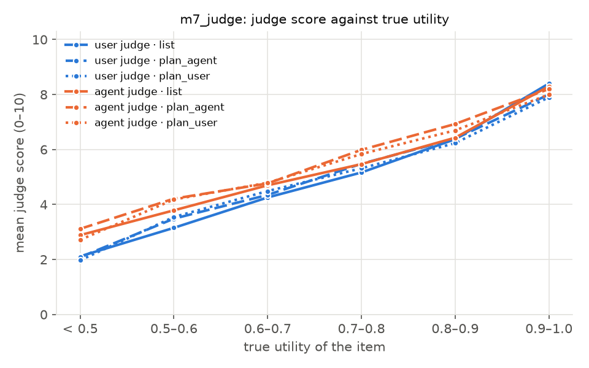

# Judge study: m7_judge

- Source run: m5_full (replicate 0, eval split, fingerprint `1d7d03d877b0093a`), 48 personas, 256 units
- Provider ollama, models {'agent': 'qwen3:32b', 'user': 'llama3.3:latest'}; package version 0.0.1
- Calls planned: 270 plans, 1536 scores, 176 pairwise (8 pairs skipped: same item); failed: 0 plans, 0 judgements

## Frozen hypotheses (SPEC Q13, M7)

Persona means, paired Wilcoxon signed-rank (two-sided), Holm over J2–J6. J1 is a bootstrap CI (bar 0.5); for J6, A is the share of `first` among non-`equal` verdicts and B the share of pairs whose verdict changed with the order (bar 0.1).

| | test | A | B | n | mean A | mean B | A − B [95 % CI] | p | p (Holm) | holds |
|---|---|---|---|---|---|---|---|---|---|---|
| J1 | Spearman(score, utility), user judge, list | score | utility | 256 | 0.871 | – | [0.827, 0.906] | – | – | yes |
| J2 | ordering | best item | recommended at K = 8 | 48 | 6.771 | 6.552 | +0.219 [+0.042, +0.406] | 0.030 | 0.152 | no |
| J2 | ordering | recommended at K = 8 | recommended at K = 3 | 48 | 6.552 | 4.448 | +2.104 [+1.625, +2.604] | <0.001 | <0.001 | yes |
| J2 | ordering | recommended at K = 3 | random item | 48 | 4.448 | 2.417 | +2.031 [+1.541, +2.542] | <0.001 | <0.001 | yes |
| J3 | constraints | sel=eig_mc,upd=llm,phr=tpl@K5 | sel=eig,upd=llm,phr=tpl@K5 | 48 | 5.792 | 5.354 | +0.438 [-0.104, +0.979] | 0.107 | 0.219 | no |
| J4 | presentation | plans (mean of two) | list | 48 | 4.893 | 4.777 | +0.117 [+0.003, +0.231] | 0.070 | 0.219 | no |
| J5 | self-preference | agent judge: own − other plan | user judge: same plans | 48 | 0.116 | 0.025 | +0.091 [-0.064, +0.241] | 0.226 | 0.226 | no |
| J6 | position | first | second | 170 | 0.424 | 0.284 | – | 0.055 | 0.219 | no |

## Spearman with utility, every judge and presentation

| judge | presentation | units | Spearman [95 % CI] |
|---|---|---|---|
| user | list | 256 | 0.871 [0.827, 0.906] |
| user | plan_agent | 256 | 0.824 [0.778, 0.861] |
| user | plan_user | 256 | 0.787 [0.716, 0.842] |
| agent | list | 256 | 0.818 [0.766, 0.858] |
| agent | plan_agent | 256 | 0.744 [0.674, 0.804] |
| agent | plan_user | 256 | 0.754 [0.683, 0.813] |

## Implied slot weights (least squares of score on m_s)

The rubric implies score = 10 u, i.e. intercept 0 and the same weight on every slot.

| term | rubric | user list | user plan_agent | user plan_user | agent list | agent plan_agent | agent plan_user |
|---|---|---|---|---|---|---|---|
| intercept | 0.00 | -3.01 | -2.53 | -2.81 | -2.18 | -1.91 | -2.32 |
| climate | 1.11 | 1.40 | 1.50 | 1.38 | 1.06 | 1.38 | 1.16 |
| setting | 1.11 | 1.18 | 1.08 | 1.08 | 0.97 | 1.07 | 0.97 |
| pace | 1.11 | 1.01 | 1.08 | 1.12 | 1.07 | 0.71 | 0.97 |
| lodging | 1.11 | 1.05 | 0.99 | 1.23 | 0.94 | 1.15 | 0.98 |
| food | 1.11 | 0.67 | 0.65 | 0.43 | 0.39 | 0.44 | 0.40 |
| activity | 1.11 | 1.25 | 1.21 | 1.20 | 1.12 | 0.94 | 1.06 |
| transport | 1.11 | 1.19 | 1.03 | 0.99 | 0.61 | 0.77 | 0.70 |
| budget | 1.11 | 2.28 | 1.97 | 1.95 | 2.59 | 2.85 | 2.68 |
| trip_length | 1.11 | 1.13 | 1.14 | 1.50 | 1.64 | 1.19 | 1.98 |

## Leniency: mean score by utility

| utility | user list | user plan_agent | user plan_user | agent list | agent plan_agent | agent plan_user |
|---|---|---|---|---|---|---|
| < 0.5 | 2.11 (n 35) | 2.09 (n 35) | 1.97 (n 35) | 2.89 (n 35) | 3.11 (n 35) | 2.71 (n 35) |
| 0.5–0.6 | 3.15 (n 33) | 3.48 (n 33) | 3.55 (n 33) | 3.79 (n 33) | 4.21 (n 33) | 4.18 (n 33) |
| 0.6–0.7 | 4.26 (n 43) | 4.35 (n 43) | 4.49 (n 43) | 4.70 (n 43) | 4.77 (n 43) | 4.79 (n 43) |
| 0.7–0.8 | 5.16 (n 79) | 5.48 (n 79) | 5.32 (n 79) | 5.47 (n 79) | 5.99 (n 79) | 5.84 (n 79) |
| 0.8–0.9 | 6.38 (n 56) | 6.39 (n 56) | 6.23 (n 56) | 6.43 (n 56) | 6.93 (n 56) | 6.70 (n 56) |
| 0.9–1.0 | 8.40 (n 10) | 8.00 (n 10) | 7.90 (n 10) | 8.30 (n 10) | 8.20 (n 10) | 8.00 (n 10) |
| best item | 6.77 (n 48) | 6.73 (n 48) | 6.65 (n 48) | 6.69 (n 48) | 7.10 (n 48) | 6.92 (n 48) |
| random item | 2.42 (n 48) | 2.62 (n 48) | 2.48 (n 48) | 3.19 (n 48) | 3.62 (n 48) | 3.42 (n 48) |

## Pairwise verdicts

| A | B | both orders | order changed | first / second / equal | A won / B won | agrees with utility |
|---|---|---|---|---|---|---|
| `sel=eig_mc,upd=llm,phr=tpl@K5` | `sel=eig,upd=llm,phr=tpl@K5` | 44 | 15 (0.341) | 35 / 50 / 3 | 21 / 8 | 0.926 (of 27) |
| `sel=eig,upd=llm,phr=tpl@K8` | `sel=eig,upd=llm,phr=tpl@K3` | 44 | 10 (0.227) | 37 / 48 / 3 | 30 / 4 | 0.939 (of 33) |

## Plan fidelity (rule-matcher keywords, approximate)

| writer | plans | failed | slots named | slots with another value |
|---|---|---|---|---|
| agent | 135 | 0 | 0.936 | 0.085 |
| user | 135 | 0 | 0.932 | 0.072 |

## Score against utility

